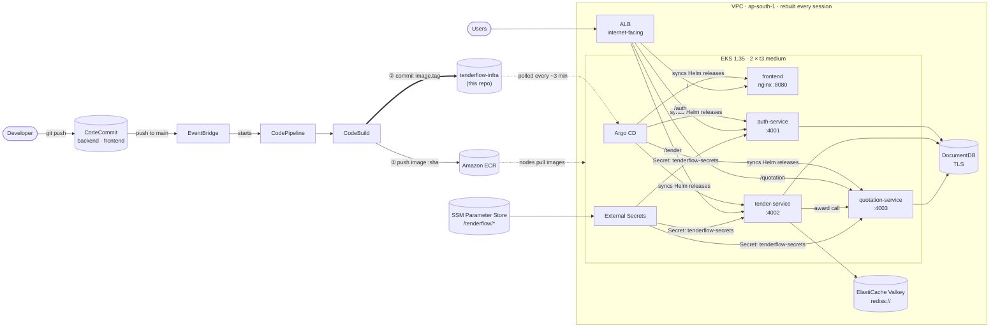
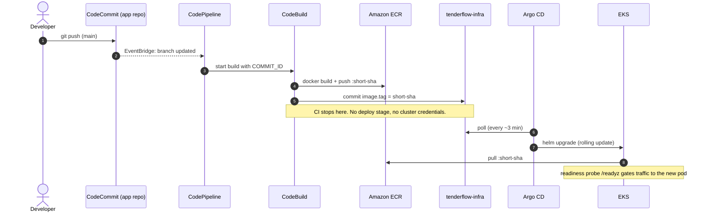
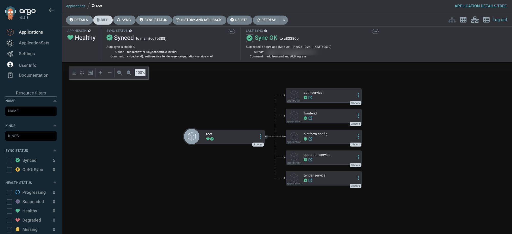
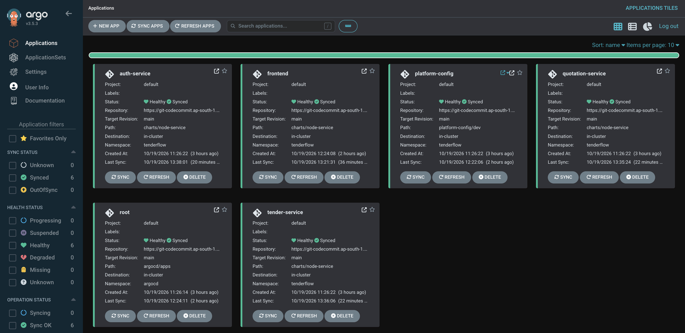
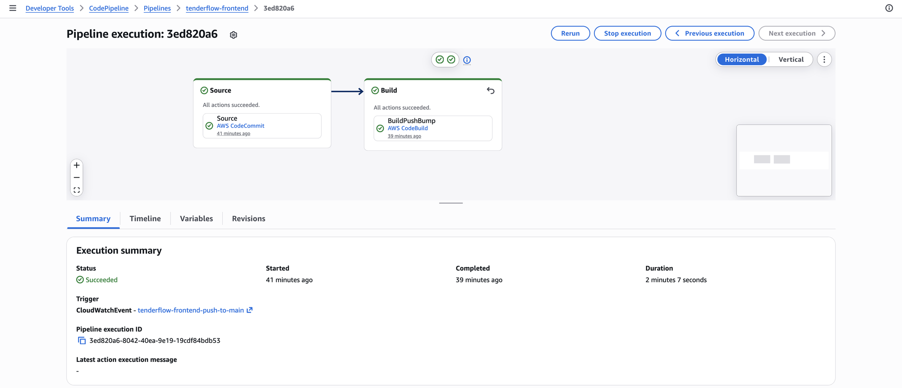
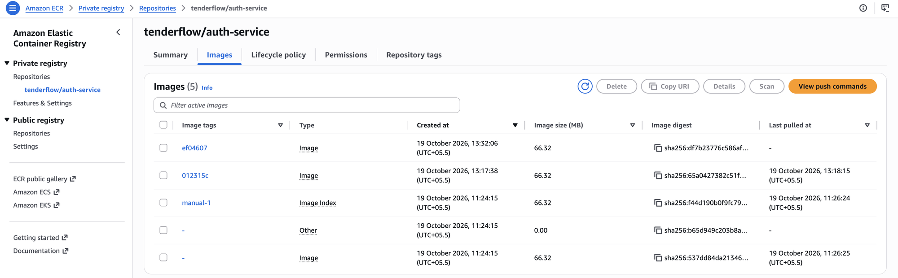
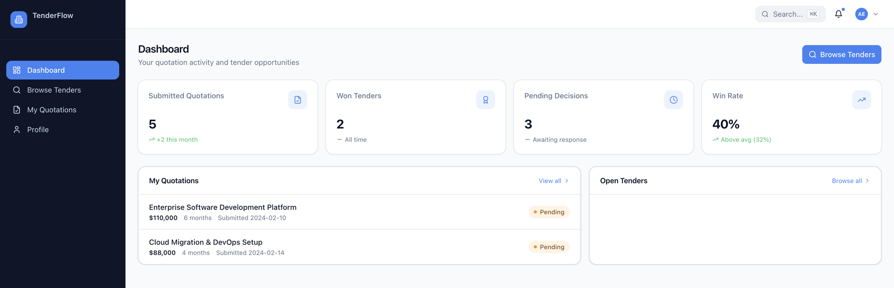

<div align="center">

# TenderFlow Platform

**A production-shaped GitOps platform on AWS, built from scratch with Terraform, EKS and Argo CD.**

A `git push` builds container images, commits the new image tag to git, and Argo CD rolls it out.<br/>
The CI system never holds cluster credentials.


</div>

---

## Contents

- [What this is](#what-this-is)
- [Architecture](#architecture)
- [How a change ships](#how-a-change-ships)
- [Repository layout](#repository-layout)
- [Infrastructure](#infrastructure)
- [The Kubernetes layer](#the-kubernetes-layer)
- [CI pipeline](#ci-pipeline)
- [Security model](#security-model)
- [Getting started](#getting-started)
- [Daily workflow](#daily-workflow)
- [Cost control](#cost-control)
- [Problems solved along the way](#problems-solved-along-the-way)
- [Roadmap](#roadmap)
- [Credits](#credits)

---

## What this is

**TenderFlow** is a tendering app: organisations publish tenders, traders submit quotations, and organisations award them. It consists of three Node.js microservices and a React frontend.

This repository is the **platform** that runs it. It provisions the cloud infrastructure, packages the services, and delivers every change to Kubernetes through Git. It was built as a hands-on exercise in the patterns real platform teams use:

| | |
|---|---|
| **Infrastructure as Code** | Every AWS resource is Terraform, split into a permanent stack and a disposable one |
| **GitOps** | The cluster's desired state lives in this repo. Argo CD makes the cluster match it |
| **Pull-based delivery** | CI builds and commits; it never runs `kubectl` and has no cluster access |
| **Secrets outside git** | Credentials live in SSM Parameter Store and are synced into pods by External Secrets |
| **Least privilege** | Every component (CI, Argo CD, controllers) gets its own narrowly scoped IAM identity |
| **Disposable environments** | The whole runtime is destroyed after each session and rebuilt from git in one command |

---

## Architecture



**One ALB acts as the API gateway.** Path prefixes match each service's Express mount, so no gateway code is needed:

| Path | Service | Port | Backed by |
|---|---|---|---|
| `/auth/*` | auth-service | 4001 | DocumentDB |
| `/tender/*` | tender-service | 4002 | DocumentDB, Valkey cache, quotation-service |
| `/quotation/*` | quotation-service | 4003 | DocumentDB |
| `/*` | frontend (nginx) | 8080 | Static React build |

The frontend is built with an empty `VITE_API_URL`, so the browser calls `/auth`, `/tender` and `/quotation` on the same origin. The ALB routes them, and no CORS is needed.

---

## How a change ships



- **Rollback is a `git revert`** of the `ci(...)` commit in this repo. Argo CD rolls the cluster back to the previous tag.
- **Every deploy is auditable.** The infra repo's history records exactly which image ran in which environment, and when.

---

## Repository layout

```text
tenderflow-infra/
├── terraform/
│   ├── bootstrap/            # PERMANENT · local state
│   │   ├── main.tf           #   S3 state bucket, 3 CodeCommit repos, 4 ECR repos
│   │   ├── pipeline.tf       #   CodePipeline ×2, CodeBuild ×2, IAM, EventBridge triggers
│   │   ├── outputs.tf
│   │   └── versions.tf
│   └── platform/             # DISPOSABLE · S3 remote state with native locking
│       ├── main.tf           #   VPC (2 AZ, single NAT) + EKS + managed add-ons
│       ├── addons.tf         #   Pod Identity roles · LB Controller · External Secrets · Argo CD
│       ├── data.tf           #   DocumentDB · ElastiCache Valkey · SSM parameters
│       ├── destroy.sh        #   safe teardown (use instead of `terraform destroy`)
│       ├── variables.tf · outputs.tf · versions.tf
├── charts/
│   └── node-service/         # one reusable Helm chart for every service
├── envs/
│   └── dev/<service>/values.yaml   # per-service config; CI bumps image.tag here
├── platform-config/
│   └── dev/                  # ExternalSecret + ALB Ingress (synced by Argo CD)
├── argocd/
│   └── apps/                 # child Applications (app-of-apps)
└── bootstrap/                # run once per cluster build
    ├── bootstrap.sh
    ├── cluster-secret-store.yaml
    ├── argocd-repo-secret.yaml
    └── root-app.yaml
```

**Related repositories**

| Repo | Contents | Pipeline |
|---|---|---|
| `tenderflow-infra` | This repo: the platform and the desired cluster state | None (Argo CD reads it) |
| `tenderflow-backend` | `auth-service/`, `tender-service/`, `quotation-service/` + `buildspec.yml` | `tenderflow-backend` |
| `tenderflow-frontend` | React + Vite app, `Dockerfile.prod` (nginx) + `buildspec.yml` | `tenderflow-frontend` |

---

## Infrastructure

The Terraform is split by **lifetime**, so expensive compute can be destroyed daily while code, images and history survive.

### `terraform/bootstrap`: permanent

| Resource | Notes |
|---|---|
| S3 bucket `tenderflow-tfstate-<account-id>` | Versioned, encrypted, public access blocked, `prevent_destroy` |
| CodeCommit × 3 | `tenderflow-backend`, `tenderflow-frontend`, `tenderflow-infra` (`prevent_destroy`) |
| ECR × 4 | `tenderflow/<service>`: **immutable tags**, scan on push, keeps the last 10 images |
| CodePipeline × 2 (V2) | Source → Build, `QUEUED` execution mode, **no deploy stage** |
| CodeBuild × 2 | AL2023 x86_64 image, privileged mode for Docker, 7-day log retention |
| EventBridge rules × 2 | Start the pipeline the moment `main` changes (no polling) |
| IAM roles × 3 | CodeBuild, CodePipeline, EventBridge, each scoped to exactly what it needs |

### `terraform/platform`: rebuilt every session

| Resource | Notes |
|---|---|
| VPC | 2 AZs, public + private subnets, **one** NAT gateway, subnets tagged for ALB discovery |
| EKS 1.35 | Managed node group: 2 × `t3.medium` (AL2023). Kept on a version in standard support |
| EKS add-ons | VPC CNI, CoreDNS, kube-proxy, Pod Identity Agent, EBS CSI (default gp3 StorageClass) |
| AWS Load Balancer Controller | Helm, Pod Identity. Turns the Ingress into an ALB |
| External Secrets Operator | Helm, Pod Identity. Read-only on `/tenderflow/*` in SSM |
| Argo CD | Helm. Reached by `kubectl port-forward` (no public endpoint) |
| DocumentDB 8.0 | TLS enforced, encrypted, `skip_final_snapshot` for clean teardown |
| ElastiCache Valkey | At-rest and in-transit encryption (`rediss://`) |
| SSM parameters | `mongo-uri`, `redis-uri`, `jwt-secret` as `SecureString`, generated by Terraform |

> **Why Terraform installs Argo CD.** Argo CD has to exist before it can deploy anything, so the platform tools (Argo CD, LB Controller, External Secrets) come from Terraform and everything app-related comes from Argo CD.

---

## The Kubernetes layer

### App of apps

`bootstrap/root-app.yaml` creates a single **root** Application that watches `argocd/apps/`. Every file there is a child Application:

```text
root  ──►  platform-config   (ExternalSecret + Ingress)
      ──►  auth-service      ┐
      ──►  tender-service    │  charts/node-service
      ──►  quotation-service │  + envs/dev/<svc>/values.yaml
      ──►  frontend          ┘
```

All apps use **automated sync with `prune` and `selfHeal`**. A manual `kubectl edit` is reverted, and anything deleted from git is deleted from the cluster.

### One chart, four services

`charts/node-service` is a small, reusable chart (Deployment + Service). Each service only declares what differs:

```yaml
# envs/dev/tender-service/values.yaml
image:
  repository: <account-id>.dkr.ecr.ap-south-1.amazonaws.com/tenderflow/tender-service
  tag: 012315c          # bumped by CI

port: 4002

env:
  QUOTATION_SERVICE_URL: http://quotation-service:4003

secretEnv:              # keys pulled from the shared Secret
  - MONGO_URI
  - REDIS_URI
  - JWT_SECRET
```

| Value | Default | Purpose |
|---|---|---|
| `livenessPath` | `/healthz` | Process is alive |
| `readinessPath` | `/readyz` | Database connected. Gates traffic during rollouts |
| `secretEnv` | `[]` | Keys injected from `tenderflow-secrets` |
| `env` | `{}` | Plain environment variables |
| `resources` | 50m CPU / 128–256Mi | Requests and limits |

### Secrets flow

```text
Terraform ──► SSM Parameter Store ──► External Secrets ──► Secret "tenderflow-secrets" ──► pod env
              (SecureString)          (Pod Identity,        (refreshed hourly)
                                       read-only /tenderflow/*)
```

Argo CD's own Git credentials follow the same path: they are stored in SSM and materialised as a repository Secret by an `ExternalSecret`, so they survive every cluster rebuild.

---

## CI pipeline

Each app repo has a `buildspec.yml`. Both follow the same three phases:

| Phase | What happens |
|---|---|
| **pre_build** | Validate `COMMIT_ID` (passed in from the pipeline's source variables), log in to ECR |
| **build** | `TAG = first 7 chars of the commit`. For each service: **skip if the tag already exists** (tags are immutable), otherwise `docker build` and `docker push` |
| **post_build** | **Guarded by `CODEBUILD_BUILD_SUCCEEDING`**: clone `tenderflow-infra`, set the tag line in each `values.yaml`, commit as `tenderflow-ci`, then `git pull --rebase && git push` with retries |

Design details that matter:

- **The source zip has no `.git` directory.** The commit SHA is passed explicitly as `#{SourceVariables.CommitId}`.
- **`post_build` runs even when `build` fails.** The guard stops CI from ever pointing the cluster at an image that was never pushed.
- **Two pipelines can push to the infra repo at once.** The rebase-and-retry loop makes concurrent backend and frontend builds safe.
- **The tag bump is a targeted `sed`**, not a YAML re-serialiser. Every CI commit is a clean one-line diff.
- **Every script block uses `set -euo pipefail`.** One failed service build fails the whole job instead of being skipped silently.
- **Re-running a pipeline is a no-op.** An existing tag is skipped and an unchanged values file means nothing to commit.

---

## Security model

| Principal | Can do | Cannot do |
|---|---|---|
| **CodeBuild role** | Push to the 4 ECR repos · `GitPull`/`GitPush` on `tenderflow-infra` · write its own logs | Touch the cluster, read app source repos directly, read secrets |
| **CodePipeline role** | Read the 2 app repos · start the 2 builds · use the artifact bucket | Anything else |
| **Argo CD** (`argocd-codecommit` user) | `GitPull` on `tenderflow-infra` only | Push, or read any other repo |
| **External Secrets** (Pod Identity) | Read `/tenderflow/*` in SSM | Write anything |
| **LB Controller / EBS CSI** (Pod Identity) | Their AWS-managed policies | — |

Further measures:

- **No long-lived cluster credentials anywhere in CI.** Production changes only through a reviewed git commit.
- **No secrets in git.** `.gitignore` blocks state files, `.tfvars`, `.env*`, keys and kubeconfigs.
- **Immutable, scanned images**, tagged by commit, so every running pod traces back to a commit.
- **Non-root containers.** The Node images run as `node` and the frontend uses `nginx-unprivileged`.
- **TLS to every data store.** DocumentDB uses a CA bundle baked into the images, and Valkey uses `rediss://`.

---

## Getting started

### Prerequisites

- AWS account with IAM Identity Center (SSO) and a CLI profile
- Terraform ≥ 1.10, AWS CLI v2, kubectl, Helm, Docker (with `buildx` on Apple Silicon)

```bash
export AWS_PROFILE=<your-profile>
```

### 1. Bootstrap (once)

```bash
cd terraform/bootstrap
terraform init && terraform apply
```

Then set the state bucket name from the `tfstate_bucket` output in `terraform/platform/versions.tf`, and push the app code to the `tenderflow-backend` and `tenderflow-frontend` CodeCommit repos. The first push builds the first images.

### 2. Give Argo CD read access to this repo (once)

```bash
aws iam create-user --user-name argocd-codecommit
aws iam put-user-policy --user-name argocd-codecommit --policy-name infra-read-only \
  --policy-document '{"Version":"2012-10-17","Statement":[{"Effect":"Allow","Action":"codecommit:GitPull","Resource":"arn:aws:codecommit:ap-south-1:<account-id>:tenderflow-infra"}]}'

# Create the HTTPS Git credential and store it straight in SSM. It is never printed.
read -r GIT_USER GIT_PASS < <(aws iam create-service-specific-credential \
  --user-name argocd-codecommit --service-name codecommit.amazonaws.com \
  --query 'ServiceSpecificCredential.[ServiceUserName,ServicePassword]' --output text)
aws ssm put-parameter --name /tenderflow/argocd/git-username --type SecureString --value "$GIT_USER"
aws ssm put-parameter --name /tenderflow/argocd/git-password --type SecureString --value "$GIT_PASS"
unset GIT_USER GIT_PASS
```

### 3. Bring the platform up (each session)

```bash
cd terraform/platform
terraform init && terraform apply                              # ~20 min (EKS + DocumentDB)
aws eks update-kubeconfig --region ap-south-1 --name tenderflow
cd ../.. && ./bootstrap/bootstrap.sh                           # Argo CD takes over from here
kubectl get applications -n argocd -w
```

`bootstrap.sh` applies the SSM `ClusterSecretStore` and Argo CD's repo credential, creates the `tenderflow` namespace, waits for the credential to sync, and applies the root app.

### 4. Open it

```bash
# The app
kubectl -n tenderflow get ingress tenderflow       # ADDRESS = the ALB hostname

# Argo CD UI at https://localhost:8080 (user: admin)
kubectl -n argocd get secret argocd-initial-admin-secret -o jsonpath='{.data.password}' | base64 -d; echo
kubectl -n argocd port-forward svc/argocd-server 8080:443
```

### 5. Tear it down (end of every session)

```bash
cd terraform/platform && ./destroy.sh
```

> **Use `destroy.sh`, not `terraform destroy`.** The ALB and EBS volumes are created by controllers inside the cluster, so Terraform doesn't know about them. The script deletes them through Kubernetes first. Otherwise the VPC deletion hangs and orphaned resources keep billing.

---

## Daily workflow

| I want to… | Do this |
|---|---|
| Deploy a change | Push to `main` in the app repo. That's all |
| See what's deployed | `git log` in this repo, or the Argo CD UI |
| Roll back | `git revert <ci-commit>` here and push |
| Retry a failed build | CodePipeline console → **Release change** |
| Deploy faster than the 3-minute poll | Argo CD UI → **Refresh** on the app |
| Change config (env vars, resources) | Edit `envs/dev/<svc>/values.yaml`, then commit and push |
| Edit this repo | **`git pull` first**, because CI commits here too |

---

## Cost control

Built on a personal account, so cost was a design constraint:

- **Two stacks by lifetime.** Only cheap, idle-friendly resources (S3, ECR, CodeCommit, pipelines) stay up permanently.
- **Destroy after every session.** EKS, NAT, DocumentDB, ElastiCache and the ALB bill by the hour, so they only exist while in use.
- **A single NAT gateway** instead of one per AZ.
- **Small instance classes**: `t3.medium` nodes, `db.t4g.medium`, `cache.t4g.micro`.
- **EKS kept in standard support.** Extended support costs about 6× more for the control plane.
- **Housekeeping:** ECR keeps 10 images per repo, build logs expire after 7 days, pipeline artifacts after 7 days.
- **An AWS Budgets alert** on the account as a safety net.

---

## Problems solved along the way

Real issues hit while building this, and their fixes:

| Symptom | Cause | Fix |
|---|---|---|
| Pods in `CrashLoopBackOff` with `Unsupported mechanism [ -301 ]` | MongoDB driver 7.x defaults to SCRAM-SHA-256, which DocumentDB rejects | `authMechanism=SCRAM-SHA-1` in the connection string, verified first with a throwaway pod |
| First pipeline run: `not authorized to perform codecommit:GetBranch` | A pipeline starts the moment it's created, before its IAM policy finished attaching | `depends_on` the role policy |
| Probes silently ignored | Values keys (`readinessProbe:`) the chart never reads | Chart exposes `livenessPath` / `readinessPath`; values must match the chart's keys |
| `no such host` from kubectl | The EKS endpoint changes on every rebuild | `aws eks update-kubeconfig` after each apply |
| Services or Argo CD failing to install | LB Controller webhook not ready yet | `depends_on` the controller's Helm release |
| Helm "invalid chart URL" | Markdown-wrapped `<https://…>` pasted into Terraform | Plain URLs |
| CI commits reformatting YAML | `yq` normalises whitespace and comments | Targeted `sed` plus a verification `grep` |
| "Pipeline is green but pods didn't change" | Argo CD polls git every ~3 min (CodeCommit can't send it webhooks) | Expected; use **Refresh** for instant sync |

---

## Roadmap

- [ ] VPC CNI prefix delegation (t3.medium caps out at 17 pods per node)
- [ ] `prod` environment with a manual approval stage
- [ ] HTTPS on the ALB (Route 53 + ACM)
- [ ] Prometheus + Grafana, and an HPA on tender-service
- [ ] ECR pull-through cache for Docker Hub base images
- [ ] Path-filtered pipeline triggers (skip builds for docs-only changes)
- [ ] Argo CD managing its own Helm release
- [ ] Codify the `argocd-codecommit` IAM user in Terraform

---

## Screenshots

| Argo CD: app of apps | Argo CD: all apps Synced and Healthy |
|---|---|
|  |  |

| CodePipeline: triggered by push | ECR: immutable SHA tags |
|---|---|
|  |  |



---

## Credits

- **Platform** (this repo: Terraform, Helm, Argo CD, CI/CD): Het Jasani
- **Application** (TenderFlow services and frontend): the TenderFlow team

Built as a personal learning project. No configuration, code or secrets were taken from any employer.
